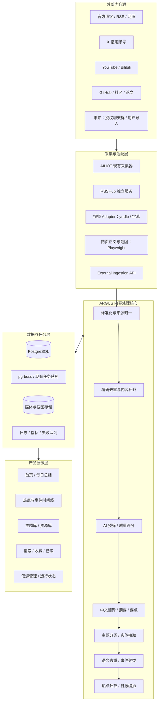

# ARGUS 最终版开发方案

## AI 情报与知识中枢：产品、UI、前后端架构与分阶段实施

-   版本：V1.0 Final
-   项目名称：**ARGUS**
-   产品定位：**AI Intelligence & Knowledge Hub**
-   中文定位：AI 情报与知识中枢
-   品牌主张：**观世界 · 见未来**
-   首期方向：AI 技术与开发情报
-   后续方向：网络安全、数据安全、AI Agent 安全、经授权接入的聊天群内容
-   参考基线：`KKKKhazix/AIHOT`
-   视觉规范：见同目录 `design.md`
-   视觉参考图：`assets/ARGUS_东方水墨品牌识别板.png`、`assets/ARGUS_网站首页视觉参考.png`

------------------------------------------------------------------------

## 0. 给 AI 编程助手的总指令

你负责开发 ARGUS。必须先审查并运行 AIHOT
上游项目，再逐步扩展；禁止在未审查现有实现的情况下重写整套系统。

核心要求：

1.  以 `https://github.com/KKKKhazix/AIHOT` 为主工程基础，先阅读仓库中的
    `AGENTS.md`、README、架构、信源、部署、数据库迁移和测试文档。
2.  首先完成基线检查：启动原项目、运行测试、记录当前技术栈、路由、数据库模型、任务队列、信源类型、日报与热点实现。
3.  品牌和 UI 已确定为东方水墨 /
    自然编辑风。不要再生成多套风格供选择；直接按同目录 `design.md`
    实现。
4.  复用 AIHOT 已有的采集、去重、AI
    筛选、评分、事件聚类、日报、主题页、RSS/API/MCP
    能力。新增平台优先实现独立 Adapter。
5.  首期以 AI 主题为主，安全主题的数据结构提前预留，第二阶段再扩展。
6.  所有内容统一进入一套内容模型；视频、文章、帖子、仓库更新和未来授权聊天消息必须可追溯到原始来源。
7.  后台执行采集、翻译、总结、评分和日报生成。页面读取已处理结果，不允许在页面请求期间同步调用大模型。
8.  复用现有
    PostgreSQL、任务队列和部署方式。未经评估不得增加第二套主数据库、第二套
    RSS 阅读器或独立工作流系统。
9.  所有私人内容默认私有。网页、搜索、API、RSS、MCP、截图和媒体访问都必须执行服务端权限校验。
10. 每个阶段先列出修改文件、迁移、接口和测试计划；小步提交；报告实际测试结果，不能声称未执行的测试通过。
11. 不得将 API Key、Cookie、Token 写入源码、前端
    bundle、日志或测试快照。
12. 不绕过平台登录、验证码、付费墙或反爬保护；遵守平台条款、API
    配额和版权要求。
13. 如果上游项目现状与本文描述不一致，以实际代码为准，记录差异并选择最小风险的适配方案，而不是盲目套用文档。
14. 任何新功能都应有可复现测试、错误状态、重试/幂等逻辑、运行日志和部署说明。

------------------------------------------------------------------------

## 1. 产品目标与边界

### 1.1 产品目标

ARGUS
是一个个人优先的跨平台情报收集与知识沉淀网站，持续追踪用户关注的博主、官方账号、技术社区、视频频道、开源仓库和未来经授权接入的聊天群，将分散内容转化为：

-   每日中文精选日报：当天关注源中值得阅读的内容、推荐理由、摘要和原文链接。
-   每日热点：从多个信源发现近期值得关注的事件和趋势。
-   视频学习库：元数据、封面、可用字幕、章节、中文摘要和原视频跳转。
-   主题知识库：按主题聚合内容，默认按时间从新到旧查看。
-   可检索的长期资料库：收藏、已读状态、个人备注、全文搜索和相关事件。
-   可运营的采集系统：信源管理、失败重试、模型预算、来源健康度和人工复盘。

核心链路：

**多源采集 → 内容标准化 → 精确去重 → 内容补齐 → AI 预筛/评分 →
中文翻译与总结 → 语义去重/事件聚类 → 热点分析 → 日报编排 →
主题归档与检索。**

### 1.2 首期范围（MVP）

-   网站品牌与基础 UI。
-   登录与私有访问控制。
-   官方 RSS/博客、GitHub 动态、指定 X 账号。
-   YouTube 和 Bilibili 指定频道/UP 主的新内容发现。
-   视频元数据、封面、可用字幕、章节/时间戳和中文总结。
-   每日日报、滚动热点、主题时间线、搜索和收藏。
-   来源管理、采集状态、失败任务重试、模型成本/预算。
-   AI 主题分类、质量评分、去重和事件聚类。
-   原文链接和可用图片/截图展示。

### 1.3 非 MVP / 明确暂缓

-   自动下载和托管完整视频。
-   无限制抓取全平台全部用户。
-   绕过平台登录、验证码、付费墙或反爬措施。
-   未经授权的微信/QQ 私人群聊 Hook、模拟登录或风控规避。
-   首期建设复杂的多租户 SaaS、商业计费、移动原生 App。
-   另建第二套 RSS 阅读器、工作流引擎或主数据库。
-   让 AI 自动对外发布帖子、发消息、评论或执行写操作。
-   在热点信息不足时编造趋势曲线或虚构热度数值。

------------------------------------------------------------------------

## 2. 品牌与最终视觉方向

### 2.1 品牌定义

-   名称：**ARGUS**
-   Logo 字标：`ARGUS`
-   Logo 副标题：`AI INTELLIGENCE HUB`
-   产品完整定位：`AI Intelligence & Knowledge Hub`
-   中文主标语：**观世界 · 见未来**
-   首页辅助文案：**从纷繁信息中，发现真正重要的内容。**

品牌概念来自"观测、洞察、知识沉淀"。视觉采用用户已选定的第三款方案：东方水墨、圆形观测之眼、山水意境、暖纸白背景和极简编辑排版。

### 2.2 最终视觉资产

-   `assets/ARGUS_东方水墨品牌识别板.png`：品牌与 Logo 方向参考。
-   `assets/ARGUS_网站首页视觉参考.png`：网站首页视觉参考。

概念图用于确定构图、氛围和视觉语言，不是可直接拆解的
HTML/CSS，也不是最终矢量 Logo。开发时应根据 `design.md` 用
SVG/可编辑路径重绘标记，并使用真实数据构建
UI；不要把概念图整张铺成网页背景。

### 2.3 设计决策

-   主风格：**东方水墨 / 自然编辑风**。
-   布局原则：借鉴 Notion
    的导航清晰、信息层级、搜索和知识组织能力，但不照搬 Notion
    品牌与具体界面。
-   背景：暖纸白，局部使用淡墨山水纹理。
-   文字：深墨黑为主，灰墨为次。
-   强调色：低饱和印章红，仅用于少量重要标记。
-   内容卡片：轻边框、浅阴影、留白充足，重点突出标题、摘要和来源。
-   首屏：品牌视觉可有气质，但日报、热点和精选内容必须尽快进入首屏，不得让大幅装饰图挤占主要阅读区域。
-   主题模式：首版优先浅色；组件与颜色令牌应为未来深色模式留出扩展空间。
-   具体颜色、字体、组件、响应式和验收规范见 `design.md`。

------------------------------------------------------------------------

## 3. 产品信息架构与页面

### 3.1 主导航

1.  **首页**：今日摘要、精选、热点、最新内容。
2.  **每日总结**：按日期查看历史日报。
3.  **热点**：近期事件、趋势状态、多来源时间线。
4.  **主题分类**：按主题查看内容时间线。
5.  **资源库**：教程、视频、论文、GitHub 仓库、Skills、MCP、工具。
6.  **关注源**：博主、频道、官方博客、论坛、仓库。
7.  **收藏**：收藏内容、待读内容和个人备注。
8.  **设置**：模型、预算、时区、日报时间、权限与保留策略。
9.  **管理（管理员）**：采集任务、失败队列、来源健康度、模型调用量、运行日志。

### 3.2 首页

建议布局： - 顶部：Logo、主导航、搜索、用户菜单。 -
首屏：日期、今日一句话摘要、3--5 条今日关键洞察。 -
核心区：今日精选内容，按价值排序而不是按平台分组。 -
侧栏/辅助区：今日热点、主题快捷入口、待阅读。 -
下方：最新内容、优质学习资源、近期趋势。 -
来源健康和运行指标只在管理页面展示，不要占用普通阅读首页。

### 3.3 日报页

每条精选内容至少显示： - 中文标题与原始标题。 -
作者/频道、来源平台、发布时间。 - 2--5 句中文摘要。 - 3--5
条关键要点。 - "为什么值得看"。 - 主题标签、内容类型和质量评分。 -
原文链接、封面/截图或视频跳转。 - 视频字幕/章节可用时提供展开入口。 -
全文翻译默认折叠，避免页面冗长与不必要的版权内容再分发。

日报结构： 1. 今日摘要。 2. 必看精选。 3. 按主题分类。 4. 优质学习资源。
5. 今日新趋势。 6. 值得继续跟踪。 7. 来源覆盖和采集异常说明。

### 3.4 热点页

热点与日报必须是两个独立产品视图： -
日报回答"我关注的信源今天发布了什么值得看"。 -
热点回答"最近发生了什么、为什么重要、趋势如何变化"。

每个热点事件显示： - 一句话结论与重要性。 -
首次出现时间、最近进展时间。 - 多来源原文链接。 -
事件时间线与关联主题。 - 状态：新出现 / 持续升温 / 有新进展 / 已降温。 -
只有存在足够历史数据时才展示趋势图或增长率。

### 3.5 主题时间线

首期 AI 主题： - AI 技术与模型 - Vibe Coding / AI 编程 - Agent / Skills
/ MCP - UI/UX 与 AI 设计 - LLM / 推理 / 多模态 - RAG / 数据工程 -
开源项目与工具 - 论文与学习路线 - 产品发布与行业趋势

每个主题支持： - 默认按发布时间倒序。 -
日期、来源、作者、内容类型、质量分筛选。 -
全文搜索（仅索引允许保存的正文/字幕）。 - 收藏、已读、个人备注。 -
关联事件、关联资源和同一事件的其他来源。

后续安全主题： - AI Agent 安全 - LLM 安全与红队 - 网络安全攻击与防护 -
数据安全与 DLP - 数据治理与合规 - 行业解决方案与案例

------------------------------------------------------------------------

## 4. 首批信源策略

首批建议 20--30
个高质量来源，先验证质量与成本，不以采集数量为成功指标。以下为候选清单，开发前需确认具体频道/账号
ID、当前更新频率、采集接口与平台规则。

### 4.1 官方与一手来源

-   OpenAI News / Developers：https://openai.com/news/
-   Anthropic News：https://www.anthropic.com/news
-   Google DeepMind Blog：https://deepmind.google/discover/blog/
-   Hugging Face Blog：https://huggingface.co/blog
-   Hugging Face Papers：https://huggingface.co/papers
-   GitHub AI & ML：https://github.blog/ai-and-ml/
-   Vercel Blog：https://vercel.com/blog
-   Cursor Changelog：https://cursor.com/changelog
-   LangChain Blog：https://blog.langchain.com/
-   arXiv cs.AI：https://arxiv.org/list/cs.AI/recent
-   arXiv cs.CL：https://arxiv.org/list/cs.CL/recent

### 4.2 X 账号候选

-   Simon Willison：LLM 工具、提示注入、AI 工程实践。
-   Andrej Karpathy：LLM 原理、学习和 AI 编程。
-   Boris Cherny：Claude Code 实践。
-   swyx：AI Engineering 和开发者生态。
-   McKay Wrigley：AI 应用与编码 Agent 工作流。
-   Harrison Chase：Agent、LangChain、工具调用生态。
-   Jerry Liu：RAG、检索和 LLM 应用架构。
-   Guillermo Rauch：Vercel、AI UI 和产品实践。
-   Theo / t3.gg：AI 编程工具、全栈开发。
-   Andrew Ng：AI 教育、Agent 学习和应用落地。

X 接入优先复用 AIHOT 现有 `x_search`
能力（实际字段与依赖以仓库为准）。若依赖第三方
API，应配置预算、频率、失败熔断和使用量统计。RSSHub
路由仅作为备选，需要验证认证、稳定性和平台合规性。

### 4.3 YouTube 频道候选

-   Anthropic：https://www.youtube.com/@anthropic-ai
-   OpenAI：https://www.youtube.com/@OpenAI
-   AI Engineer：https://www.youtube.com/@aiDotEngineer
-   Fireship：https://www.youtube.com/@Fireship
-   Theo / t3.gg：https://www.youtube.com/@t3dotgg
-   IndyDevDan：https://www.youtube.com/@indydevdan
-   Cole Medin：https://www.youtube.com/@ColeMedin
-   AI Jason：https://www.youtube.com/@AIJasonZ
-   Matt Pocock：https://www.youtube.com/@mattpocockuk
-   DesignCourse：https://www.youtube.com/@DesignCourse
-   Figma：https://www.youtube.com/@Figma

### 4.4 Bilibili UP 主候选

-   跟李沐学 AI：论文精读与模型原理。
-   五道口纳什：机器学习、强化学习和技术推导。
-   程序员鱼皮：AI 编程、Vibe Coding、项目实战。
-   AI 超元域：Agent、开源项目、多智能体实践。
-   黑马程序员：系统教程与工程实战。
-   图灵的猫：AI 科普和工具观察。
-   良睦路程序员：模型部署、微调和工程实践。
-   马克的技术工作坊：Skills、MCP 与 LLM 应用开发。
-   吴恩达相关官方课程：系统化学习资源。

开发时优先以频道/UP 主 ID 为主键，不要仅依赖名称搜索；B 站视频需保留 BV
号和分 P 信息。

### 4.5 社区与开源动态

-   GitHub Trending：https://github.com/trending
-   Hacker News：https://news.ycombinator.com/
-   Reddit r/LocalLLaMA：https://www.reddit.com/r/LocalLLaMA/
-   Reddit r/ClaudeAI：https://www.reddit.com/r/ClaudeAI/
-   Reddit r/MachineLearning：https://www.reddit.com/r/MachineLearning/
-   V2EX、掘金及其他技术社区：优先官方接口、RSS、公开且合规的页面，或用户手动添加链接。

### 4.6 后续聊天群

按平台官方 API、Bot、Webhook
或用户主动导出优先。只接入明确授权的群，默认匿名化成员身份；群消息必须标记私有可见范围，不能进入公开
RSS/API/MCP 或匿名页面。对于没有稳定合规 API 的平台，不以模拟登录、Hook
个人账号或规避风控作为生产方案。

------------------------------------------------------------------------

## 5. 开源项目与复用策略

  ----------------------------------------------------------------------------------------------------------------------------------------------------------------------------
  项目                     地址                                                复用职责                                     约束
  ------------------------ --------------------------------------------------- -------------------------------------------- --------------------------------------------------
  AIHOT                    https://github.com/KKKKhazix/AIHOT                  主站、信源管理、采集、AI                     核心基础。先跑通基线，保留 MIT
                                                                               筛选、去重、评分、聚类、日报、热点、主题页   许可与版权声明，替换品牌。

  RSSHub                   https://github.com/DIYgod/RSSHub                    将可支持的平台/网页转换成 RSS/Atom           优先独立服务部署，避免直接复制其代码；AGPL-3.0
                                                                                                                            需评估许可义务。

  yt-dlp                   https://github.com/yt-dlp/yt-dlp                    支持平台的视频元数据、封面和可用字幕采集     作为独立 Adapter/子进程调用；默认不下载完整视频。

  youtube-transcript-api   https://github.com/jdepoix/youtube-transcript-api   补充 YouTube 字幕获取                        字幕缺失、访问限制和异常必须显式处理。

  Bilibili-Agent-mcp       https://github.com/Gsxcheng/Bilibili-Agent-mcp      参考 B 站视频、字幕、搜索等读取能力          先做代码审查和稳定性验证；不接入不需要的写操作。

  Playwright               https://github.com/microsoft/playwright             对允许访问的网页生成截图                     域名白名单、超时和并发限制；防 SSRF。

  Faster-Whisper（可选）   https://github.com/SYSTRAN/faster-whisper           在允许处理且没有可用字幕时做本地转录         非 MVP；评估算力、版权与平台规则后再启用。
  ----------------------------------------------------------------------------------------------------------------------------------------------------------------------------

注意： - 不能因为项目开源，就认为所有平台采集方式均被允许。 -
每个依赖都要记录版本、许可证、维护状态和安全风险。 - 不要同时引入
FreshRSS/Miniflux 作为第二个主阅读器。 - 不首期引入 n8n
作为核心调度层，优先使用 AIHOT 现有任务队列。 -
上游依赖升级要独立评估，避免把大版本升级和业务改造混在一起。

------------------------------------------------------------------------

## 6. 总体技术架构

### 6.1 技术栈基线

以 AIHOT 当前仓库的实际版本为准，优先沿用：

-   TypeScript / Node.js。
-   React Router 前端路由与页面框架。
-   Fastify API 服务。
-   PostgreSQL。
-   pg-boss 或仓库当前使用的任务队列。
-   Tailwind CSS 或当前样式系统。
-   Docker Compose。
-   Playwright、yt-dlp 等专用工具以独立 Adapter/任务方式集成。
-   可配置的 OpenAI-compatible LLM API。

原则：先复用，后扩展；不因某个新 Adapter 而改变整个技术栈。

### 6.2 主要组件职责

-   **Web App**：页面渲染、搜索、筛选、收藏、已读、主题和详情。
-   **API 服务**：认证、授权、内容查询、信源配置、日报/热点、运行状态。
-   **Worker**：采集、正文补齐、视频字幕、AI
    处理、事件聚类、日报生成和清理任务。
-   **Source
    Adapter**：隔离每个平台的访问、解析、限速、错误处理和平台差异。
-   **AI Pipeline**：预筛、评分、翻译、摘要、分类、聚类与热点解释。
-   **Media Service**：封面、截图、字幕、章节与存储。
-   **Admin
    Console**：来源健康、失败队列、模型预算、任务重试和人工复盘。

------------------------------------------------------------------------

## 7. 后端架构与模块设计

### 7.1 模块划分

建议以现有 AIHOT
目录结构为准进行模块化，不要求机械地新建同名目录。逻辑上至少包括：

1.  `auth`：登录、会话、角色、权限。
2.  `sources`：信源 CRUD、类型配置、开关、健康状态。
3.  `collectors`：调度、增量游标、速率限制、Adapter 注册。
4.  `content`：统一内容模型、详情、搜索、收藏、已读、备注。
5.  `media`：封面、截图、视频字幕、章节和状态。
6.  `ai-pipeline`：预筛、评分、翻译、摘要、分类、实体抽取。
7.  `deduplication`：精确去重、近似去重、事件聚类。
8.  `trends`：热点得分、事件状态和变化。
9.  `digest`：日报生成、历史版本、重跑和人工编辑。
10. `topics`：主题定义、标签、主题时间线。
11. `jobs`：任务状态、重试、幂等键、死信/失败任务。
12. `settings`：模型、预算、时区、日报时间、保留策略。
13. `audit`：管理员操作、采集错误、模型调用和权限拒绝日志。

### 7.2 Adapter 统一接口

每个来源 Adapter 至少支持：

-   `validateConfig(config)`：校验配置。
-   `fetchItems(cursor, since)`：增量拉取。
-   `normalize(raw)`：转成统一内容对象。
-   `healthCheck()`：健康检查。
-   `getCapabilities()`：声明支持正文、图片、视频元数据、字幕、评论或其他能力。
-   `getRateLimit()`：提供频率/预算提示。
-   `getCursor()` / `persistCursor()`：可靠记录增量游标。

规则： - Adapter 必须幂等。 -
认证失败、限流、暂时不可用、内容删除、永久失败要区分错误类型。 -
单个来源失败不能阻塞其他来源。 -
采集请求必须有超时、最大响应体和并发上限。 -
平台写操作默认不开放；只做读取和内容整理。

### 7.3 任务队列

优先复用 AIHOT 已有队列和调度机制。逻辑任务类型：

-   `source.fetch`：采集信源增量。
-   `content.enrich`：正文、封面、字幕和截图补齐。
-   `content.prefilter`：规则和轻量模型预筛。
-   `content.analyze`：评分、摘要、翻译、分类。
-   `event.cluster`：近似内容聚类。
-   `trend.recompute`：热点分数刷新。
-   `digest.generate`：日报生成。
-   `media.screenshot`：网页截图。
-   `retention.cleanup`：过期缓存和数据清理。
-   `source.healthcheck`：来源健康检查。

每类任务需要： - 幂等键。 - 最大重试次数。 - 指数退避。 - 任务超时。 -
失败原因和下一次重试时间。 - 手动重试入口。 - 预算/并发限制。

### 7.4 后端 API 设计

先复用现有路由和 API 风格；以下为逻辑 API 契约，实际路径要与 AIHOT
已有接口协调，不能未经检查直接重复创建。

  逻辑接口                              用途
  ------------------------------------- ----------------------
  `GET /api/digests?date=`              获取某天日报
  `POST /api/digests/:date/generate`    管理员触发日报重跑
  `GET /api/hot-topics`                 获取当前热点列表
  `GET /api/events/:id`                 获取事件聚类与时间线
  `GET /api/topics`                     获取主题列表
  `GET /api/topics/:slug/items`         获取主题内容时间线
  `GET /api/content`                    搜索/筛选内容
  `GET /api/content/:id`                获取内容详情
  `POST /api/content/:id/save`          收藏/取消收藏
  `POST /api/content/:id/read-status`   更新已读状态
  `POST /api/content/:id/feedback`      提交质量/分类反馈
  `GET /api/sources`                    获取来源列表
  `POST /api/sources`                   新增来源
  `PATCH /api/sources/:id`              修改来源配置
  `POST /api/sources/:id/test`          试抓或健康检查
  `POST /api/sources/:id/pause`         暂停来源
  `POST /api/sources/:id/resume`        恢复来源
  `GET /api/jobs`                       查看任务与失败状态
  `POST /api/jobs/:id/retry`            手动重试任务
  `GET /api/usage`                      查看模型调用量和预算
  `GET /api/settings`                   获取可安全公开的配置
  `PATCH /api/settings`                 更新管理员配置

写操作必须做身份、权限、输入校验和 CSRF/Origin
等适当防护。接口不得把服务端密钥返回前端。

------------------------------------------------------------------------

## 8. 前端架构与页面实现

### 8.1 前端原则

-   先检查 AIHOT 现有路由、组件、数据请求与样式系统。
-   复用现有组件，优先将视觉令牌与组件样式替换为 ARGUS 规范。
-   页面不负责抓取外部平台，也不直接调用 LLM 生成内容。
-   通过 API 读取已落库内容，提供明确的加载、空、错误和部分失败状态。
-   权限由服务端保证；前端隐藏入口不等于安全控制。

### 8.2 建议页面/路由

按现有 Router 约定映射实际路径，逻辑路由建议：

-   `/`：首页。
-   `/daily`：日报列表。
-   `/daily/:date`：单日日报。
-   `/hot`：热点趋势。
-   `/events/:id`：热点事件详情。
-   `/topics`：主题总览。
-   `/topics/:slug`：主题时间线。
-   `/library`：资源库。
-   `/content/:id`：内容详情。
-   `/sources`：关注源管理。
-   `/saved`：收藏与待读。
-   `/settings`：用户/系统设置。
-   `/admin/jobs`：任务状态。
-   `/admin/usage`：模型预算和用量。

### 8.3 核心组件

-   `AppShell`：主布局、侧栏/顶栏、响应式容器。
-   `BrandLogo`：ARGUS 图标与字标。
-   `GlobalSearch`：全局搜索。
-   `DailyBriefHeader`：日报日期与摘要。
-   `ContentCard`：通用内容卡片。
-   `VideoContentCard`：视频封面、时长、字幕状态和原链接。
-   `TopicTag`：主题标签。
-   `SourceBadge`：来源平台。
-   `QualityScore`：评分及评分解释。
-   `EventClusterCard`：事件聚类与多来源入口。
-   `TimelineList`：主题时间线。
-   `SourceHealthRow`：来源状态。
-   `JobStatusTable`：任务状态和重试操作。
-   `EmptyState` / `ErrorState` / `LoadingSkeleton`：空、错、加载状态。
-   `SaveButton` / `ReadStatusToggle`：收藏和已读。
-   `TranslationPanel`：原文与中文翻译切换。
-   `TranscriptPanel`：字幕、章节和时间戳。

### 8.4 视觉实现要求

-   按 `design.md` 使用暖纸白、深墨文字、灰墨辅助文字和克制的印章红。
-   山水背景仅用于品牌区、首页顶部或专题头图；正文阅读区域保持干净。
-   内容卡片优先使用来源封面/视频缩略图，缺图使用中性占位。
-   卡片标题、来源、时间、摘要和原文入口必须清晰；标签不要过多。
-   不使用概念图直接充当完整网页背景。
-   不使用虚构数据填充热点榜、阅读量、评分或趋势图。
-   图片固定比例并懒加载，防止页面布局跳动。
-   重要状态不能只靠颜色表达；需要文字或图标辅助。

------------------------------------------------------------------------

## 9. 数据库与统一内容模型

开发前必须检查 AIHOT 现有 schema、迁移与
ORM。以下是逻辑实体，不代表必须新建同名表。优先扩展现有表并保持迁移向后兼容。

### 9.1 核心实体

  --------------------------------------------------------------------------------------------------------------------------------
  实体                                主要字段/职责
  ----------------------------------- --------------------------------------------------------------------------------------------
  `Source`                            来源类型、平台、名称、URL/平台 ID、配置、开关、游标、最后成功/失败时间、健康状态、预算

  `Content`                           统一内容记录、作者、标题、原文链接、正文、语言、发布时间、采集时间、媒体元数据、哈希、状态

  `ContentAnalysis`                   中文标题、摘要、翻译、要点、推荐理由、评分分项、主题标签、模型/提示词版本

  `Topic`                             主题名称、slug、描述、规则、颜色/图标配置、是否启用

  `ContentTopic`                      内容与主题的多对多关联

  `EventCluster`                      事件标题、摘要、首次出现、最新更新、趋势状态、事件分数

  `EventContent`                      事件与来源内容关联及主/次来源角色

  `DailyDigest`                       日期、摘要、生成状态、版本、内容顺序、人工修订状态

  `UserContentState`                  用户收藏、已读、备注、反馈

  `MediaAsset`                        封面、截图、字幕文件/文本、存储位置、哈希、可见性

  `JobRun`                            任务类型、状态、尝试次数、错误、耗时、幂等键

  `ModelUsage`                        模型、请求类型、输入/输出 token、成本估算、缓存命中、时间

  `AuditLog`                          管理员操作、权限拒绝、配置变更和关键安全事件
  --------------------------------------------------------------------------------------------------------------------------------

### 9.2 Content 逻辑字段

-   `id`
-   `source_id`
-   `platform`
-   `external_id`
-   `canonical_url`
-   `author_name` / `author_handle` / `author_url`
-   `title_original` / `title_zh`
-   `body_original`
-   `summary_zh`
-   `translation_zh`
-   `key_points`
-   `why_it_matters`
-   `content_type`
-   `language`
-   `published_at` / `collected_at` / `updated_at`
-   `thumbnail_url` / `image_urls` / `embed_url` / `screenshot_asset_id`
-   `transcript_status` / `transcript_text` / `chapters`
-   `topic_tags` / `entity_tags`
-   `score_total` / `score_breakdown` / `selection_status`
-   `content_hash` / `duplicate_of` / `event_id`
-   `visibility` / `retention_until`

### 9.3 视频扩展

-   平台视频 ID、频道/UP 主 ID、BV 号、分 P ID。
-   时长、封面、视频页 URL。
-   字幕语言、字幕来源、获取时间和失败原因。
-   带时间戳的字幕片段与章节。
-   `transcript_hash`。
-   `media_processing_status`。

字幕缺失或获取失败时必须保存明确状态，不能把空字幕当成有效转录，也不能编造逐字稿。

### 9.4 索引与去重

-   唯一约束：`platform + external_id`（适用的平台内容）。
-   对规范 URL 和内容哈希建立适当索引。
-   对发布时间、来源、主题关联、事件关联建立查询索引。
-   搜索先复用现有全文搜索能力；仅在真实需求出现后评估 pgvector
    或外部搜索引擎。
-   事件聚类与内容精确去重分离：同一内容去重，同一事件多来源保留。

------------------------------------------------------------------------

## 10. AI 处理流水线与内容质量

### 10.1 流水线

1.  规范化 URL、平台 ID、作者和时间。
2.  规则预过滤：广告、抽奖、明显无关、重复转载。
3.  精确去重：平台 ID、规范 URL、正文哈希。
4.  内容补齐：正文、封面、字幕和截图。
5.  轻量预筛：主题相关性和明显低价值过滤。
6.  质量评分：相关性、实践价值、新颖度、可信度、讨论趋势。
7.  中文化：中文标题、摘要、关键要点和推荐理由。
8.  分类：主题、内容类型、产品/工具/模型实体。
9.  语义去重与事件聚类。
10. 热点趋势计算。
11. 日报编排。
12. 主题归档、搜索索引与人工反馈。

### 10.2 初始评分权重

建议起始权重，可通过配置与人工反馈调整：

-   主题相关性：30%。
-   实践/学习价值：25%。
-   新颖度：20%。
-   来源可信度：15%。
-   讨论增长与跨来源信号：10%。

评分原则： - 官方来源可信度高，但不代表每条内容都有高学习价值。 -
教程要有步骤、代码、演示或可执行方法才应获得较高实践分。 - GitHub
项目应提取解决的问题、核心功能、许可证、更新时间和适用场景。 -
论文应提取研究问题、方法、结果、局限、代码/数据集链接。 -
纯转载、营销软文、标题党和缺少原始来源的内容降权。 -
不以单一点赞数、播放量或粉丝数决定排序。 -
保存评分分项、模型版本和提示词版本，便于复盘。

### 10.3 成本与可靠性

-   先规则/轻量模型预筛，再调用高成本模型。
-   按内容哈希、模型版本和提示词版本缓存结果。
-   对每个模型/API 设置每日预算、并发上限、超时、重试上限和熔断阈值。
-   页面访问不触发模型调用。
-   人工纠正的分类和事件关系默认优先于自动结果，重跑时不得无条件覆盖。
-   失败任务可重试；重试不应重复创建内容或重复计费。

------------------------------------------------------------------------

## 11. 日报、热点与趋势计算

### 11.1 日报规则

-   时区固定为 `Asia/Shanghai`（北京时间）。
-   出刊时间：每天 08:00；上海日期 D 的刊期仍为 D。
-   日报 D 覆盖前一个上海自然日，即 `[beijingAt(D-1, 00:00), beijingAt(D, 00:00))`，等价于 `beijingAt(D, 00:00) - 24h` 至 `beijingAt(D, 00:00)`；08:00 只是出刊时间，不是覆盖窗口终点。
-   支持手动生成/重跑与版本记录；自动补刊不改写已发布历史刊，手动重跑保留修订。
-   日报按价值和主题平衡排序，避免单一平台刷屏。
-   一条内容可属于多个主题，但在同一日报主列表中只出现一次。

### 11.2 热点计算

初始逻辑可使用可解释的加权分数：

`hot_score = freshness + source_diversity + relevance + engagement_velocity + novelty`

具体归一化方式由实现根据真实数据确定，不得把不存在的数据当作 0
以外的虚构指标；缺少互动数据时降低该分项权重并标记数据不完整。

热点需要区分： - 新出现：近时间窗首次出现。 -
持续升温：相关内容数量/讨论增速上升。 -
有新进展：事件出现实质性新内容。 - 已降温：最近新增内容和讨论明显减少。

热点页保留事件时间线与多来源原文。没有足够历史数据时，只显示定性状态，不展示虚构趋势图。

------------------------------------------------------------------------

## 12. 图片、截图、字幕和媒体处理

-   优先展示平台原生封面与官方嵌入播放器。
-   网页截图通过 Playwright 在后台按需生成，不阻塞正文入库。
-   视频默认采集元数据、封面和可用字幕，不默认下载完整视频。
-   字幕与截图保存来源 URL、采集时间、关联内容 ID 和处理状态。
-   图片处理失败不应丢弃文字内容。
-   外部 URL 抓取必须防
    SSRF：拒绝环回、内网、链路本地、云元数据地址；验证重定向目标，限制端口、响应大小和超时。
-   对外展示只保存必要摘要和元数据；遵守平台规则、版权和内容授权范围。
-   视频详情提供原视频链接、可用章节/字幕及中文总结。

------------------------------------------------------------------------

## 13. 权限、安全与隐私

### 13.1 默认私有

AIHOT 当前的匿名阅读默认策略需要根据实际代码确认并调整。ARGUS
应默认需要登录，至少保护： -
首页中的私人内容、搜索、主题时间线、收藏和详情。 - RSS/API/MCP 输出。 -
截图、字幕和媒体资源。 - 群聊摘要、消息和附件。 -
管理员的来源配置、模型配置、日志和任务操作。

不能只在前端隐藏内容；后端每个查询、导出和媒体读取接口都必须校验访问权限。

### 13.2 密钥与日志

-   API Key、Cookie、Token 只放在服务端环境变量或加密配置中。
-   `.env.example` 只能放占位符。
-   日志禁止输出完整凭证、私人聊天原文和敏感请求头。
-   记录管理员的关键配置变更与权限拒绝。
-   配置速率限制、输入大小限制和管理员操作审计。
-   支持来源暂停、数据删除、缓存清理和备份恢复。

### 13.3 私有聊天内容

-   仅接入用户明确授权的群和时间范围。
-   默认对成员身份做匿名化或最小化保存。
-   配置群消息可见范围和保留期限。
-   私有聊天内容不得进入匿名公开页面、公开 RSS、搜索引擎索引或公开 API。
-   支持停止采集和删除已采集数据。

------------------------------------------------------------------------

## 14. 运行、部署与配置

### 14.1 部署原则

-   首期使用 AIHOT 现有 Docker Compose 与部署流程。
-   PostgreSQL、API、Worker 和媒体存储按现有结构运行。
-   RSSHub 如需要则独立容器运行，不直接混入主项目代码。
-   `yt-dlp` 等工具按固定版本安装，记录版本并测试升级。
-   生产部署应配置 HTTPS、持久化卷、备份和恢复演练。

### 14.2 配置项建议

实际变量名遵循 AIHOT 现有约定，以下是逻辑配置：

-   `APP_BASE_URL`
-   `APP_TIMEZONE=Asia/Shanghai`
-   `DAILY_DIGEST_HOUR=8`
-   `DATABASE_URL`
-   `LLM_BASE_URL`
-   `LLM_API_KEY`
-   `LLM_MODEL_FAST`
-   `LLM_MODEL_QUALITY`
-   `LLM_DAILY_BUDGET`
-   `SOURCE_FETCH_CONCURRENCY`
-   `SOURCE_REQUEST_TIMEOUT`
-   `MEDIA_STORAGE_PATH` 或对象存储配置
-   X / 第三方 API 凭证
-   RSSHub 地址（若部署）
-   登录/会话密钥
-   管理员初始化配置

不得将真实密钥提交到版本库。启动时应验证必要配置，缺少可选平台凭证时只禁用对应
Adapter，不应让整个应用启动失败。

### 14.3 可观测性

记录： - 每个来源最后成功时间、成功率和错误类型。 -
每类任务的排队时间、耗时、重试次数和失败原因。 - AI
模型调用量、缓存命中、成本估算和预算剩余。 -
每日新增内容、去重比例、入选比例和日报生成状态。 -
字幕可用率、媒体处理失败率。 - 权限拒绝、管理员操作和异常请求。

日志应结构化并脱敏；不需要首期建设复杂独立监控平台，可先复用现有日志与管理页面。

------------------------------------------------------------------------

## 15. 分阶段实施与验收

### Phase 0：代码审查与基线

工作： - 克隆 AIHOT 到自有仓库。 -
阅读开发指引、架构、信源、数据库、部署与测试文档。 - 本地启动原项目。 -
执行 typecheck、test、build、smoke test。 -
输出模块复用清单、数据库实体清单、路由清单和改造风险。 -
检查许可证、第三方依赖、匿名访问默认策略与媒体存储。

验收： - 原项目可重复启动。 - 基线测试结果真实记录。 -
明确哪些能力直接复用、哪些扩展、哪些新建。 - 不在本阶段大规模重写代码。

### Phase 1：ARGUS 品牌、UI Shell 与私有访问

工作： - 替换品牌名称、Logo、文案和颜色令牌。 - 按 `design.md`
建立导航、首页框架、日报卡片、主题标签和响应式布局。 -
实现登录与统一后端授权。 - 配置 AI 主题和初始信源。 -
确保搜索、详情、媒体和 RSS/API/MCP 出口均遵守权限。

验收： - 页面视觉与选定的水墨编辑风一致。 -
登录后可以查看首页、日报、热点、主题与历史内容。 -
未授权请求无法读取私人内容。 - 现有 AIHOT 功能没有因品牌替换而回归失败。

### Phase 2：AI 信源、中文日报与热点

工作： - 接入官方 RSS/博客、GitHub 动态和指定 X 账号。 -
完成标准化、去重、评分、中文摘要、分类和事件聚类。 -
完成日报历史与热点页。 - 提供来源健康度、失败重试、预算和人工反馈。

验收： - 每条内容有原始来源、发布时间、中文摘要和原文链接。 -
同一内容不重复入库；同一事件聚合但保留所有来源。 - 日报可重跑且幂等。 -
热点分数与状态可解释，缺失数据不造假。

### Phase 3：YouTube / Bilibili 视频

工作： - 以频道/UP 主 ID 为关注对象。 - 使用 yt-dlp 与专用 Adapter
获取元数据、封面和可用字幕。 - 使用 youtube-transcript-api 作为 YouTube
字幕补充。 - 增加字幕/章节 UI、中文总结、原视频跳转和字幕状态。 -
按需生成允许访问的网页截图。

验收： - 新视频能被发现，元数据正确。 -
字幕可用时能查看/跳转；无字幕时展示明确状态。 -
不生成虚构字幕，不默认下载完整视频。 - 视频 ID、BV 号、分 P 与规范 URL
的去重有效。

### Phase 4：主题知识库与阅读体验

工作： - 完善主题时间线、搜索、过滤、收藏、已读和个人备注。 -
增加相关事件、相关资源和历史日报跳转。 - 优化桌面、平板、移动端。 -
完成空状态、错误状态、加载状态与可访问性。

验收： - 主题默认新到旧。 - 可按时间、平台、作者、类型和评分筛选。 -
收藏/已读状态跨页面一致。 - 详情页清楚区分 AI 摘要、原文和转录文本。

### Phase 5：授权聊天群

工作： - 用户确定平台和群后，优先通过官方
API/Bot/Webhook/授权导出接入。 - 复用统一内容模型和 AI 流水线。 -
加入群级权限、匿名化、保留期和删除机制。

验收： - 只采集明确授权的群。 - 私人内容无法通过公开页面/API/RSS/MCP
访问。 - 可停止采集并删除数据。

### Phase 6：安全情报主题包

工作： - 增加网络安全、数据安全、AI Agent 安全主题和信源。 -
增加攻击方式、防护手段、治理方案、行业解决方案、案例、标准和论文内容类型。 -
为安全内容配置专用评分提示词、关键词和来源权重。

验收： - AI 与安全主题可以独立筛选、生成日报和查看时间线。 -
同一内容可属于多个主题但不重复刷屏。

------------------------------------------------------------------------

## 16. 必须覆盖的测试用例

1.  同一 RSS 文章重复抓取只入库一次。
2.  同一 X 帖子多次抓取不重复生成日报条目。
3.  同一事件多来源报道被聚类，但每个原文链接保留。
4.  同一视频 BV/Video ID 重复采集不会重复入库。
5.  视频无字幕时显示明确状态，不生成虚构逐字稿。
6.  人工字幕和自动字幕来源标记正确。
7.  原始发布时间、采集时间和日报日期不混淆。
8.  Asia/Shanghai 跨日边界和每天 08:00 出刊正确。
9.  模型超时、限流和平台不可用时能重试，且不会重复入库。
10. 单来源失败不影响其他来源。
11. 日报重跑幂等，不生成重复条目。
12. 人工纠正分类/聚类后重跑不会无条件覆盖。
13. 未授权用户不能读取私人内容、搜索结果、字幕或截图。
14. 私有群聊内容无法从公开 RSS/API/MCP/站点地图泄露。
15. API Key/Cookie/Token 不会出现在前端 bundle 和日志。
16. 内网、环回和云元数据 URL 的抓取被拒绝。
17. 截图失败不导致正文丢失。
18. 关闭来源后不再创建新采集任务。
19. 备份恢复后，内容、主题、媒体和日报关联完整。
20. 页面无数据、部分失败、加载中和接口错误均有明确 UI 状态。

------------------------------------------------------------------------

## 17. Definition of Done

一个阶段只有同时满足以下条件才算完成：

-   功能按需求可用。
-   代码通过仓库现有 typecheck、test、build。
-   关键流程有自动化测试或可复现测试步骤。
-   数据库迁移可安全执行且有回滚/恢复说明。
-   `.env.example` 和部署文档已更新。
-   无真实密钥、Cookie 或私人内容进入源码/日志。
-   页面与 `design.md` 一致，桌面与移动端完成检查。
-   已知限制、未解决问题和后续任务有明确记录。
-   测试结果真实报告，不把未执行的测试描述为通过。

------------------------------------------------------------------------

## 18. 最终执行顺序

**先复用 AIHOT 并跑通基线 → ARGUS 品牌/UI 与私有访问 → AI
信源与日报/热点 → 视频字幕与媒体 → 主题知识库 → 授权聊天群 →
安全情报主题包。**

首版成功标准不是"抓取最多"，而是：

-   每天提供少而精的高价值中文内容。
-   每条内容都可追溯到原文。
-   同一事件不会重复刷屏。
-   视频能看到封面、字幕状态和中文总结。
-   历史内容可以按主题与时间找到。
-   来源失败和模型成本可观察。
-   私人内容不会意外公开。
